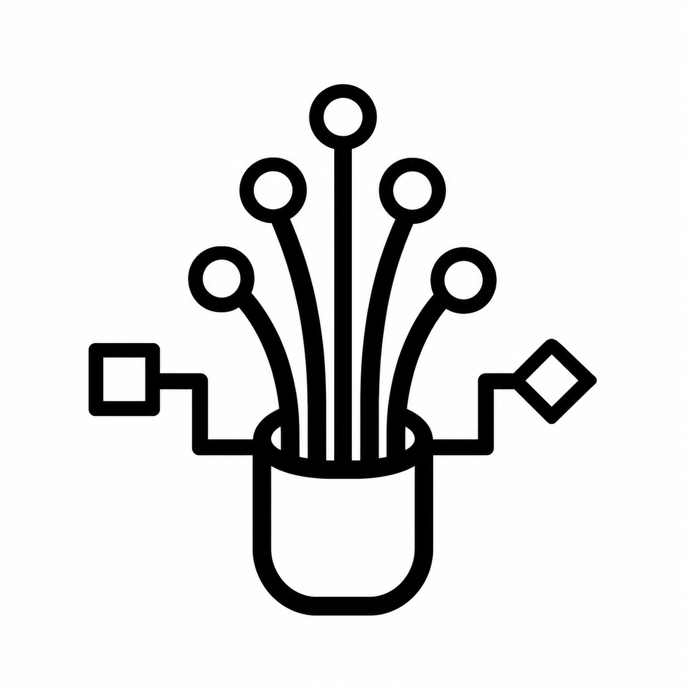

# FiberQ Schematics



**FiberQ Schematics 1.0.1** is a QGIS plugin for designing fiber-optic
schematics. Create equipment and cable routes, splice individual fibers,
trace connected paths, and produce reports and drawing exports.

- ODFs, patch panels, FDH/MDU cabinets, FAT/OTB boxes and splice closures.
- Physical cable catalogues, tube/fiber numbering and modular attachments.
- Splitters, OLTs and ONTs with optical connectors.
- Snap, Cut/Through, Join/Group join, splice points, branches and slack.
- Connected-path selection, purpose colors and optical tracing.
- Route reports, materials, design checks, optical budgets and legends.
- English/Serbian interface and PDF, SVG and DXF exports.
- Separate GeoPackage workspaces with immediate saving and session Undo/Redo.

## Requirements

QGIS **4.0–4.99**, using its bundled Python, Qt and GDAL/OGR libraries.
The release is runtime-tested on QGIS 4.2.3 / Qt 6.10.2 on Linux.
No external Python packages, AutoCAD, separate FiberQ plugin, payment or online
account are required. QGIS 3 support is not declared for this first release.

## Install and start

1. Download `fiberq_schematics-1.0.1.zip` from the release assets, or install
   from the QGIS plugin repository after approval.
2. In QGIS, use **Plugins → Manage and Install Plugins → Install from ZIP**.
   Select the ZIP and enable **FiberQ Schematics**.
3. Open a **blank QGIS project**, then press the FiberQ toolbar icon or choose
   **Vector → FiberQ Schematics → FiberQ Schematics**.
4. Use **Workspace → New** and choose a new GeoPackage. For an example, use
   **Workspace → Demonstrations → Demo**, Network demo or Splice demo.
5. Place equipment and cables from **Draw**. Use **Edit** for selection and
   movement, **Fibers** for optical operations and **Reports** for analysis.

The **Help / About** toolbar button includes local instructions, contact
details, the website, issue tracker and donation link. It works offline;
external links open only when clicked.

## Saving work

Edits save immediately to the selected GeoPackage. **Save project** writes a
QGIS project beside it. Keep both files together and use Workspace → Open to
resume editing. Earlier workspaces migrate to a new copy, preserving the
original. Unloading the plugin removes its UI and tools while retaining
project layers and saved files.

EPSG:3857 coordinates are schematic positions, not geographic locations.
Use a separate blank project and GeoPackage for a schematic. Optical budgets
use entered real cable lengths, not distances measured from the drawing.

## Build and check

```bash
python3 tools/build_plugin.py
python3 tools/validate_package.py release/fiberq_schematics-1.0.1.zip
python3 -m pip install -r requirements-dev.txt
python3 tools/check_release.py release/fiberq_schematics-1.0.1.zip
```

CI additionally runs the official QGIS Qt6 checker against the exact ZIP
using the upstream QGIS container. Reported dry-run findings fail the gate
even when the upstream process exits with zero. With that checker installed:

```bash
python3 tools/check_qt6.py release/fiberq_schematics-1.0.1.zip
```

The builder uses a file allowlist, one standard plugin folder and regular
0644 file permissions. Installers, compiled code, caches, test workspaces and
security-suppression configurations are excluded. Security/quality checks run
against the exact contents of the upload ZIP.

QGIS integration checks use disposable workspaces:

```bash
QT_QPA_PLATFORM=offscreen PYTHONPATH=/usr/share/qgis/python:tests \
  python3 -m unittest discover -s tests -p 'test_*.py'
```

## Contact and support

- Author: **Vladimir Vukovic**
- Email: [vukovicvl@fiberq.net](mailto:vukovicvl@fiberq.net)
- Website: [FiberQ Schematics](https://www.fiberq.net/fiberq-schematics/)
- Source: [GitHub](https://github.com/vukovicvl/fiberq-schematics)
- Issues: [Issue tracker](https://github.com/vukovicvl/fiberq-schematics/issues)
- Donate: [GitHub Sponsors](https://github.com/sponsors/vukovicvl)

Include your QGIS/Qt version, steps to reproduce, a traceback and an anonymized
sample when reporting an issue. Donations are optional and unlock no features.

## License

MIT; see [LICENSE](LICENSE). FiberQ CAD source-derived catalogues, translations
and ribbon images retain their MIT notice in
[FIBERQ_CAD_LICENSE.txt](FIBERQ_CAD_LICENSE.txt).
